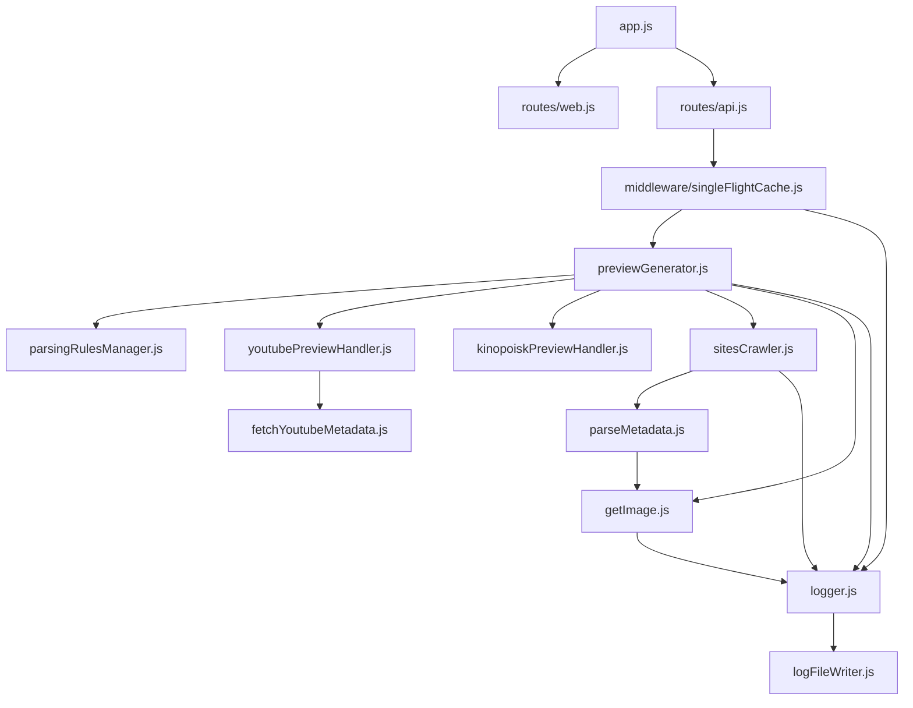

# Архитектура и модули

## Структура репозитория

```text
.
├── app.js
├── package.json
├── parsingRules.json
├── blockedDomains.json
├── debugWhitelist.env
├── middleware/
│   └── singleFlightCache.js
├── previewGeneratorEngine/
│   ├── previewGenerator.js
│   ├── sitesCrawler.js
│   ├── parseMetadata.js
│   ├── getImage.js
│   └── parsingRulesManager.js
├── routes/
│   ├── api.js
│   └── web.js
├── utils/
│   ├── helpers.js
│   ├── logger.js
│   ├── debugHandler.js
│   ├── logFileWriter.js
│   ├── youtubePreviewHandler.js
│   ├── fetchYoutubeMetadata.js
│   └── kinopoiskPreviewHandler.js
├── public/
│   ├── javascripts/
│   │   └── linkPreviewFrontendModule.js
│   └── stylesheets/
│       └── style.css
└── views/
    └── index.html
```

Каталоги `.idea` и файлы IDE не являются частью runtime-архитектуры.

## Слои приложения

### 1. Запуск и HTTP-слой

**app.js**

- Создаёт Express-приложение.
- Использует `PORT` или порт по умолчанию 3002.
- Подключает CORS для двух разрешённых origins: `https://tv.2ch.su` и `https://citx.space`.
- Раздаёт статические файлы из `public` и `views`.
- Подключает web-маршрут на `/` и API-маршруты на `/api`.
- Запускает прослушивание порта.

В коде нет middleware для проверки схемы и допустимости входящего URL, а также отдельного rate limiter или авторизации.

**routes/web.js**

Маршрут `GET /` возвращает `views/index.html`.

**routes/api.js**

Создаёт Express Router и подключает `GET /parse` к middleware, созданному через `createSingleFlightCache(parseUrl, { cacheSize: 300 })`. Поскольку router смонтирован в `/api`, полный путь — `GET /api/parse`.

### 2. Middleware кеширования

**middleware/singleFlightCache.js**

Функция `createSingleFlightCache(handler, { cacheSize = 300 })` возвращает Express middleware.

Внутри существуют две Map:

- `cache` хранит уже полученные результаты по исходной строке URL.
- `pending` хранит Promise для URL, обработка которого ещё выполняется.

Порядок работы:

1. Проверить наличие query-параметра `url`.
2. При отсутствии вернуть HTTP 400.
3. Проверить кеш и при попадании вернуть результат с `_fromCache: true`.
4. Если такой URL уже обрабатывается, дождаться его Promise и вернуть результат с `_shared: true`.
5. Иначе вызвать переданный handler, положить результат в кеш и вернуть JSON.
6. Удалить Promise из `pending` в `finally`.

Размер кеша ограничивается удалением первого ключа Map. При чтении кешированная запись не перемещается в конец, поэтому фактически это ограниченный insertion-order cache, а не полноценный LRU по последнему использованию. Кеш не имеет TTL и не сохраняется между перезапусками.

В кеш попадают все значения, успешно возвращённые handler, в том числе `null` и строки. Их последующее преобразование в объект через spread может менять форму ответа.

### 3. Ядро предпросмотра

**previewGeneratorEngine/previewGenerator.js**

Экспортирует `parseUrl(url)`. Это координатор обработки:

- читает `BLACKLISTMODE`, `WHITELISTMODE`, `IS_POSTERS_ON_BY_DEFAULT`;
- вызывает `getParsingRules()`;
- возвращает информацию о пропуске, если `skipParsing` истинно;
- проверяет YouTube и Кинопоиск;
- для обычного сайта запускает `fetchHtml()`, `parseMetadata()`, `getImage()`;
- собирает итоговый объект с ограничением длины заголовка и описания.

Ожидаемый объект обычного предпросмотра содержит `url`, `title`, `description`, `image`.

### 4. Получение и обработка HTML

**previewGeneratorEngine/sitesCrawler.js**

Экспортирует `fetchHtml(url, { fastmode = true })`.

Использует Got. Устанавливает таймаут запроса 20 секунд, до двух повторных попыток и максимум 10 редиректов. HTML получает в полном режиме при `DEBUG_LEVEL=verbose`; в остальных случаях использует streaming-режим и условия досрочной остановки.

Для декодирования кодировки используются заголовок Content-Type, meta charset, chardet, iconv-lite и запасной UTF-8.

Результаты crawler имеют поле `type` (например, `html`, `file`, `partial`, `error`) и служебные поля `fetchModeUsed` и `stopReason`. Текущий `parseUrl()` отдельно проверяет только `type === "file"`; тип `error` не обрабатывается как отдельная ветка.

### 5. Извлечение метаданных

**previewGeneratorEngine/parseMetadata.js**

Настраивает Metascraper с плагинами title, description, image, logo, url, author, publisher и date.

Если title отсутствует, пробует HTML title, og:title и h1. Если description отсутствует, ищет первый непустой p длиной более 60 символов и ограничивает его 400 символами.

При исключении возвращает пустой объект.

### 6. Выбор изображения

**previewGeneratorEngine/getImage.js**

Экспортирует `getImage(html, url, metadata, rules)`.

Приоритеты:

1. `metadata.image`, если `posterAllowed` не запрещает постер.
2. Логотип из Metascraper.
3. `og:logo`.
4. Иконки из link rel.
5. Логотип из JSON-LD.
6. Favicon по адресу `https://<hostname>/favicon.ico`.
7. `null`, если изображение не найдено.

Относительные URL преобразуются в абсолютные. Для favicon используется HEAD, а при некоторых ответах — GET. При определённых TLS-ошибках предусмотрен переход на HTTP.

### 7. Правила доменов

**previewGeneratorEngine/parsingRulesManager.js**

Экспортирует `getParsingRules()`. Функция извлекает hostname, находит правило точного домена или поддомена и вычисляет:

- `fastmode` (по умолчанию true);
- `onlyPoster` (по умолчанию false);
- `classification` (по умолчанию unknown);
- `posterAllowed`;
- `domainFoundInRules`;
- `isBlocked`;
- `skipParsing`.

Список правил импортируется из `parsingRules.json`, блок-лист — из `blockedDomains.json`.

Whitelist запрещает парсинг доменов, отсутствующих в parsingRules. Домены из blockedDomains пропускаются независимо от значения `BLACKLISTMODE`; подробности — в [аудите](audit.md).

### 8. Специализированные обработчики

**utils/youtubePreviewHandler.js** определяет YouTube URL и передаёт их в **utils/fetchYoutubeMetadata.js**. Последний обращается к YouTube Data API v3 с ключом `YOUTUBE_API_KEY`.

**utils/kinopoiskPreviewHandler.js** распознаёт URL фильмов/сериалов и обращается к Kinopoisk Unofficial API. Используется `KINOPOISK_API_KEY`.

Эти обработчики вызываются из `parseUrl()` до обычной загрузки HTML, но после проверки `skipParsing`.

### 9. Вспомогательные функции

**utils/helpers.js**

Содержит:

- `isFileUrl()` — проверяет расширение файла по pathname URL;
- `truncate()` — ограничивает длину строки;
- `extractDomain()` — извлекает hostname;
- `isPosterAllowed()` — определяет разрешение на постер.

**parsingRules.json**

Список доменных правил. Содержит поля `domain`, `classification`, `notes`, `fastmode`, а для отдельных доменов — `onlyPoster` и `posterAllowed`.

**blockedDomains.json**

Текущий список: `hdrezka.ag`, `rezka.ag`, `youtube.com`.

### 10. Логирование

В проекте есть две системы:

- **utils/logger.js** — целевой централизованный логгер проекта. Он формирует консольные записи, JSON-строки в `logs/app.log`, а крупные payload сохраняет через `logFileWriter.js` в `logs/html`. Поддерживает дочерние логгеры.
- **utils/debugHandler.js** — отдельный консольный логгер, используемый частью модулей для отладочных сообщений.

Переход оставшихся вызовов на `utils/logger.js` — будущая задача. В документации текущие два механизма описываются раздельно, без предположения, что миграция уже выполнена.

У `utils/logger.js` поле сообщения называется `message`. В нескольких вызовах `fetchYoutubeMetadata.js` передаётся поле `msg`, которое текущий логгер не использует как текст сообщения.

### 11. Клиентская часть

**views/index.html** — локальная тестовая форма, отправляющая запрос на относительный путь `/api/parse` и показывающая результат.

**public/javascripts/linkPreviewFrontendModule.js** — отдельный IIFE-модуль для CyTube. Он наблюдает за `#messagebuffer`, находит ссылки в сообщениях, вызывает API по жёстко заданному Render URL и вставляет карточку в сообщение.

Этот модуль не является тем же самым интерфейсом, что тестовая страница. Он содержит собственный клиентский кеш и собственный debug вывод.

## Основные зависимости между модулями


