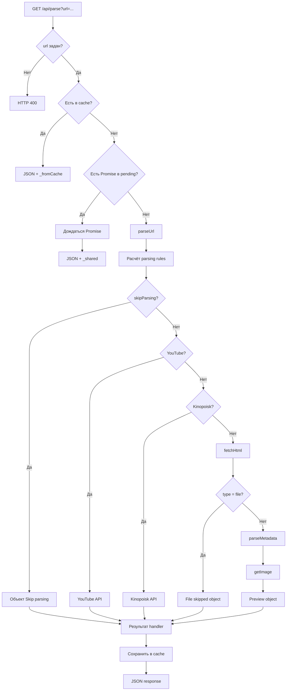

# Поток обработки запроса

## Входная точка

Основной API принимает GET-запрос:

```http
GET /api/parse?url=https%3A%2F%2Fexample.com
```

Маршрут объявлен в `routes/api.js`. До основного обработчика запрос проходит `createSingleFlightCache(parseUrl, { cacheSize: 300 })`.

## Этапы

### 1. Проверка параметра и кеша

Middleware читает `req.query.url`.

- Если параметр отсутствует или пустой, возвращается HTTP 400 с `{"error":"No URL provided"}`.
- При попадании в кеш возвращается сохранённый результат с дополнительным полем `_fromCache: true`.
- Если обработка такого URL уже выполняется, запрос ждёт общий Promise и возвращает результат с `_shared: true`.
- Иначе начинается новый вызов `parseUrl(url)`.

Ключом кеша служит исходная строка URL. Нормализации URL перед поиском в кешe нет.

### 2. Расчёт правил

`parseUrl()` читает переменные:

- `BLACKLISTMODE`;
- `WHITELISTMODE`;
- `IS_POSTERS_ON_BY_DEFAULT`.

Затем вызывает `getParsingRules(url, parsingRulesList, blockedDomains, whitelistMode, isPostersOnByDefault)`.

Менеджер правил:
- определяет домен;
- определяет, относится ли URL к файлу по расширению;
- ищет правило домена или поддомена;
- выбирает `fastmode`, `onlyPoster`, `classification`;
- вычисляет разрешение постера;
- применяет whitelist;
- проверяет blockedDomains.

Если `skipParsing` равно true, возвращается объект с сообщением о пропуске и рассчитанными правилами.

### 3. Специализированные ветки

После проверки `skipParsing`:

1. YouTube URL передаётся в `fetchYoutubePreview()`.
2. URL фильма/сериала Кинопоиска передаётся в `fetchKinopoiskPreview()`.

Эти ветки не проходят через обычный crawler и `getImage()`. Они возвращают собственные структуры результата.

### 4. Обычная обработка сайта

Для остальных URL вызывается `fetchHtml(url, { fastmode: rules.fastmode })`.

Возможные варианты crawler:

- `type: "file"` — `parseUrl()` возвращает объект с `note: "Skipped because file link"`.
- `type: "html"` — HTML передаётся на извлечение метаданных.
- `type: "partial"` — частичный HTML также передаётся дальше.
- `type: "error"` — специальной ветки обработки в `parseUrl()` нет; код продолжает работу с полем `html`, которого в таком результате нет.

Затем:

1. `parseMetadata(html, url)` получает метаданные.
2. `getImage(html, url, metadata, rules)` выбирает изображение.
3. Заголовок ограничивается 100 символами, описание — 200.
4. При `rules.onlyPoster === true` заголовок и описание заменяются пустыми строками.
5. Возвращается объект `{ url, title, description, image }`.

### 5. Завершение и кеширование

Middleware сохраняет результат handler в памяти и отправляет JSON. Promise удаляется из `pending` в `finally`.

Ошибки, выброшенные handler и не перехваченные внутри него, приводят к HTTP 500. Однако часть внутренних обработчиков самостоятельно перехватывает ошибки и возвращает `null`, пустой объект или другую строку; такие результаты не обязательно приводят к HTTP 500.

## Поведение crawler

Параметр `fastmode` влияет на раннюю остановку streaming-загрузки, но не является единственным переключателем между полной и потоковой загрузкой.

### Полная загрузка

При `DEBUG_LEVEL=verbose` crawler использует `got(url, { responseType: "buffer" })`, получает полный ответ, декодирует его и возвращает `fetchModeUsed: "full"`.

### Потоковая загрузка

В остальных режимах используется `got.stream()`.

Общие ограничения:
- таймаут запроса — 20 секунд;
- retry limit — 2;
- максимум 10 редиректов;
- порог размера накопленного буфера — 10 000 000 байт.

При `fastmode === true` crawler пытается остановиться, когда `</head>` найден в первых 4096 байтах накопленного ответа. Если это условие не сработало, выполнение продолжается к остальным оптимизированным проверкам.

В потоковом режиме также проверяются:
- meta description;
- JSON-LD с description или headline;
- значимый текст в p (не менее 50 символов) или h1 (не менее 20 символов);
- достижение лимита размера.

Если ни одно условие не сработало до конца потока, возвращается весь накопленный HTML.

### Декодирование

Порядок определения кодировки:
1. charset в HTTP Content-Type;
2. meta charset в первых 4096 байтах;
3. результат chardet;
4. UTF-8 по умолчанию.

Известные псевдонимы кодировок нормализуются. Если iconv-lite не поддерживает найденную кодировку, используется UTF-8.

## Диаграмма обработки



## Важные особенности

- Для YouTube правило в `blockedDomains.json` может остановить обработку до специального YouTube handler.
- При ошибке crawler в streaming-режиме Promise может быть отклонён объектом ошибки; внешний catch в `parseUrl()` возвращает строку `"test"`.
- Ветка verbose crawler возвращает объект с `type: "error"`, но `parseUrl()` не проверяет этот тип явно.
- Результаты `null` и строки также могут попасть в кеш.
- Кеш и pending общие для всех запросов одного процесса, но не разделяются между несколькими экземплярами приложения.
